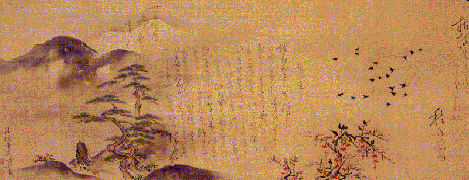

## Hi there! 👋

- 🐧 A Linux lover, I use [Nix](https://nixos.org/), and [Arch](https://archlinux.org/), and love tons of open source stuffs.
- 💻 Full stack web developer, I write [`Rust`](https://docs.rs/), and [`JavaScript`](https://developer.mozilla.org/en-US/docs/Web/JavaScript) a lot.
- 🤔 Research on this and that, used to be focusing on [🕸️ networks](https://www.usenix.org/conference/nsdi22).
- 🌱 A student, and always a student, learning.
- 🌍 I speak 🇨🇳 中文, 🇺🇸 English, 🇯🇵 日本語, and a bit of 🇩🇪 Deutsche and 🇫🇷 Française (for now).
- 🥇 A retired competitive programmer, though not so good, I look into [algorithms](https://github.com/ahacad-bots/algo-templates).

<!---->
<!---->
<!-- 
<b>枯れ枝に 烏のとまりけり 秋の暮れ</b>
 -->

<b>寒月や 門なき寺の 天高し</b>

<!--与謝蕪村-->
